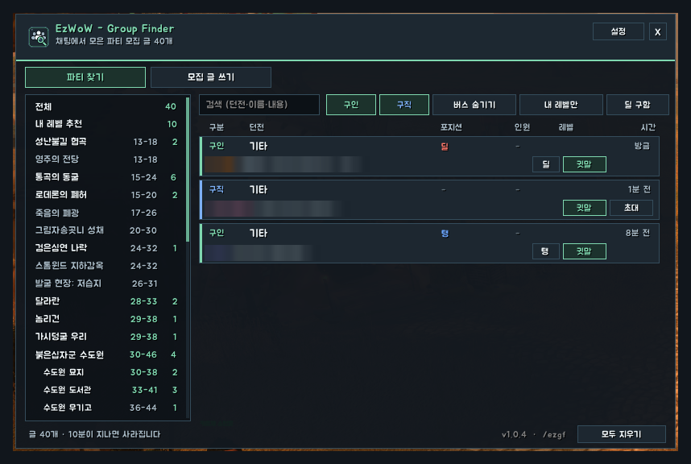
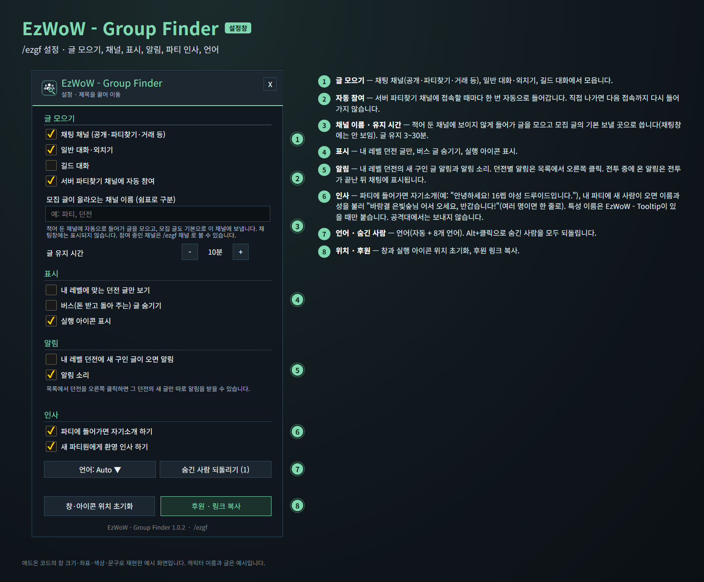
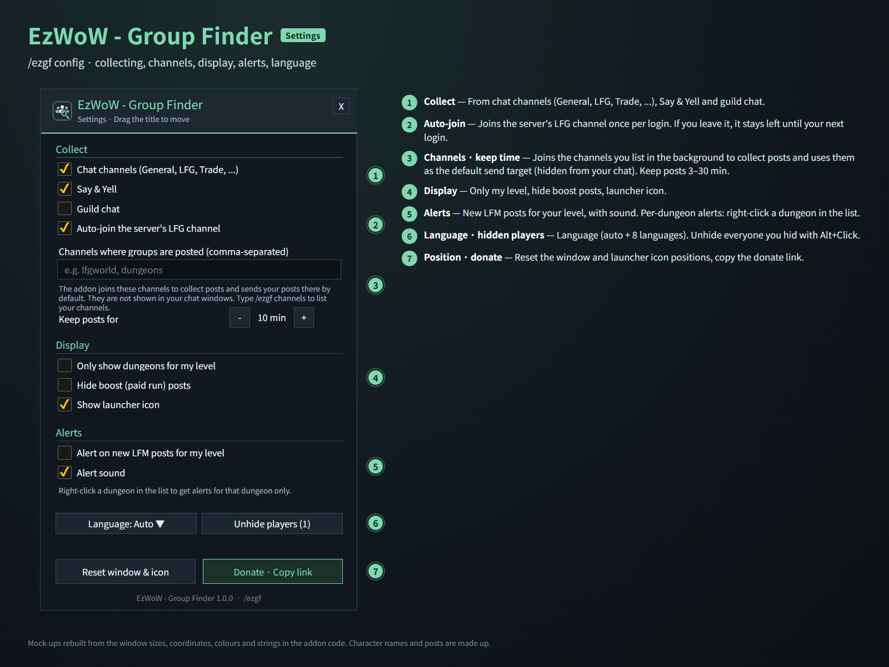

# EzWoW - Group Finder

채팅에 올라온 파티 모집 글을 던전별로 모아 보여 주고, 모집 글을 쉽게 써서 보낼 수 있게 돕는 애드온입니다.
Collects group posts from chat by dungeon and helps you write and send your own.

- 명령어 / Commands: `/ezgf`, `/파티찾기`, `/ezwowgroupfinder` (`/ezgf 설정` · `/ezgf config`, `/ezgf 모집` · `/ezgf post`)

## 한국어

> 애드온 코드의 창 크기·좌표·색상·문구로 재현한 예시 화면입니다. 캐릭터 이름과 글은 예시입니다.

### 파티 찾기
- 채팅 채널(공개·파티찾기·거래 등), 일반 대화·외치기, 길드 대화(선택)에서 파티 모집 글을 자동으로 모읍니다.
- 서버 파티찾기 채널에는 접속할 때마다 한 번 자동으로 들어갑니다. 직접 나가면 다음 접속까지 다시 들어가지 않습니다.
- 설정에 적어 둔 채널에도 보이지 않게 들어가 글을 모읍니다(채팅창에는 표시되지 않음).
- 던전별로 나눠 보여 주고, 지금 레벨에 맞는 던전은 레벨 범위를 민트색으로 표시합니다. `내 레벨 추천`에서 한 번에 볼 수 있습니다.
- 글마다 구인/구직/버스, 필요한 역할(탱·힐·딜), 인원, 레벨, 올린 시간이 표시됩니다.
- 같은 사람이 다시 올리면 새 글로 바뀌고, 정해진 시간(기본 10분, 3~30분)이 지나면 사라집니다.
- 글을 클릭하면 귓속말, 구직 글에는 초대 버튼이 있습니다. Alt+클릭으로 그 사람 글을 숨깁니다(설정에서 되돌리기).
- 검색과 필터: 구인·구직, 버스 숨기기, 내 레벨만.
- `딜 구함` 칩: 왼쪽 클릭으로 켜고 끄고, 오른쪽 클릭으로 내 역할을 탱 → 힐 → 딜로 바꿉니다. 켜면 내 역할을 구하는 모집 글만 보입니다(역할이 적히지 않은 글은 그대로).

### 모집 글 쓰기
- 모집 방식, 던전, 역할, 인원, 메모를 고르면 글을 만들어 줍니다. 보내기 전에 직접 고칠 수 있습니다.
- 보낼 채널을 고르고 버튼 한 번으로 보냅니다. 도배 방지를 위해 30초에 한 번까지 보낼 수 있습니다.

### 알림
- 목록에서 던전을 오른쪽 클릭하면(별 표시) 그 던전의 새 글이 올라올 때 알려 줍니다.
- 설정에서 내 레벨 던전의 새 구인 글 알림과 알림 소리를 켤 수 있습니다.
- 전투 중에 온 알림은 전투가 끝난 뒤 채팅에 표시합니다(아직 남아 있는 글만, 최근 3개까지).

### 인사
- **파티에 들어가면 자기소개 하기**(기본 켬): 다른 사람의 파티에 들어가면 파티 채팅에 레벨·특성·직업을 소개합니다. 예: `안녕하세요! 16렙 야성 드루이드입니다.` (특성 이름은 EzWoW - Tooltip이 설치되어 있을 때 붙고, 없으면 직업만 소개합니다)
- **새 파티원에게 환영 인사 하기**(기본 켬): 내 파티에 새 사람이 들어오면(내가 초대해 파티가 만들어질 때 포함) 이름과 성을 불러 인사합니다. 예: `바람결 은빛숲님 어서 오세요, 반갑습니다!` 여러 명이 함께 들어오면 `바람결 은빛숲님, 별빛노래 달무리님 어서 오세요, 반갑습니다!`처럼 한 번에 보냅니다.
- 파티에서만 보내고 공격대에서는 보내지 않습니다. 전투 중이라 채팅을 보낼 수 없으면 잠시 기다렸다가 보냅니다.
- 접속하거나 `/reload`한 뒤에는 이미 있던 파티원에게 다시 인사하지 않습니다.
- 설정창의 **인사** 구역에서 각각 끌 수 있습니다.

<!-- ezwow-pad-share -->
### 게임패드
- 게임패드 UI를 켜면 EzWoW 창을 패드로 다룰 수 있습니다. 방향키로 이동, A(✕)로 누르기, X(□)로 오른쪽 클릭, LB/RB로 스크롤, B(○)로 닫기입니다. 창 아래에 연결된 패드 모양으로 키 안내가 나옵니다.
- 블리자드 창이 열려 있지 않을 때 **보기(Back) / Create 버튼**을 누르면 화면의 EzWoW 프레임(유틸리티 바, 퀘스트 목록 등)으로 이동합니다. 다시 누르거나 B를 누르면 돌아갑니다.
- 다른 버튼을 쓰려면 설정 > 단축키 > 애드온 > EzWoW > "게임패드: EzWoW 창으로 이동/돌아가기"에 지정합니다(EzWoW-MapFinder가 설치돼 있을 때).

### 기록 공유
- 모든 EzWoW 애드온이 함께 쓰는 기록 공유가 **기본으로 켜져 있습니다**. 직접 확인한 퀘스트 NPC, 희귀 몬스터 목격, 아이템 드롭, 채집 위치를 다른 EzWoW 사용자와 나눕니다.
- `/ezshare` 또는 `/공유`: `on` / `off` 켜기·끄기, `channel on` / `channel off` 서버 채널 사용, `status` 현재 상태와 기록 수.

## English

> Mock-ups rebuilt from the window sizes, coordinates, colours and strings in the addon code. Character names and posts are made up.

### Find Group
- Collects group posts from chat channels (General, LFG, Trade, ...), Say/Yell and, optionally, guild chat.
- Joins the server's LFG channel once per login. If you leave it, it stays left until your next login.
- Also joins the channels you list in the settings in the background (hidden from your chat windows).
- Sorted by dungeon; level ranges that suit you are highlighted in mint, and `For My Level` shows them all at once.
- Each post shows LFM/LFG/boost, roles needed, group size, level and age.
- A player's newer post replaces the older one; posts expire after 10 minutes (3–30, adjustable).
- Click a post to whisper; LFG posts have an Invite button. Alt+Click hides that player (undo in the settings).
- Search and filters: LFM/LFG, hide boosts, my level only.
- `Need DPS` chip: left-click turns it on/off, right-click cycles your role Tank → Heal → DPS. When on, only groups that need your role are shown (posts that name no role still show).

### Write Post
- Pick the post type, dungeon, roles, group size and a note to build the message; edit it freely before sending.
- Choose a channel and send with one click (at most once every 30 seconds).

### Alerts
- Right-click a dungeon in the list (star) to be alerted about its new posts.
- Optionally get alerts, with sound, for new LFM posts for your level.
- Alerts that arrive in combat are printed after the fight (only posts that are still listed, the latest 3 at most).

### Greetings
- **Introduce myself when I join a party** (on by default): when you join someone's party, your level, talent tree and class go to party chat, e.g. `Hello! Level 16 Feral Combat Druid here.` (the talent tree is added when EzWoW - Tooltip is installed; otherwise just the class).
- **Welcome new party members** (on by default): when someone joins your party (including when your invite starts a new party), greets them by full name, e.g. `Welcome, Windrift Ashvale! Nice to meet you!`. Several people joining together get one line: `Welcome, Windrift Ashvale, Starsong Moonhollow! Nice to meet you!`.
- Parties only, never in a raid. If chat is locked in combat, the line waits a little.
- After logging in or `/reload`, members already in your party are not greeted again.
- Each can be turned off in the **Greetings** section of the settings.

### Gamepad
- With the gamepad UI on, EzWoW windows work with a gamepad: D-pad to move, A (✕) to press, X (□) for right-click, LB/RB to scroll, B (○) to close. A key guide in your pad's button style shows under the window.
- With no game window open, press **View (Back) / Create** to move to the EzWoW frames on screen (Utility Bar, quest list and more). Press it again or B to go back.
- To use another button, set Key Bindings > AddOns > EzWoW > "Gamepad: move to / leave the EzWoW frames" (with EzWoW-MapFinder installed).

### Record sharing
- Record sharing, used by all EzWoW addons, is **on by default**. Quest NPCs, rare monster sightings, item drops and gathering spots you have seen yourself are shared with other EzWoW users.
- `/ezshare`: `on` / `off` to turn it on or off, `channel on` / `channel off` for the server channel, `status` for the current state and record counts.

---

## Support / 후원

If you find this addon useful, you can support its development.

애드온이 도움이 되셨다면 개발 후원으로 응원해 주세요.

[Buy Me a Coffee ☕](https://buymeacoffee.com/qqhrqqhr2)

