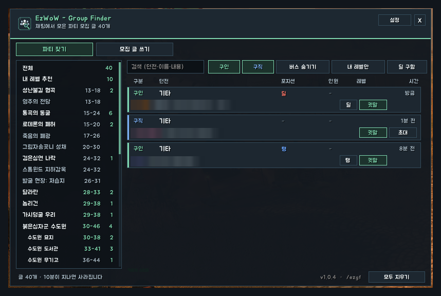
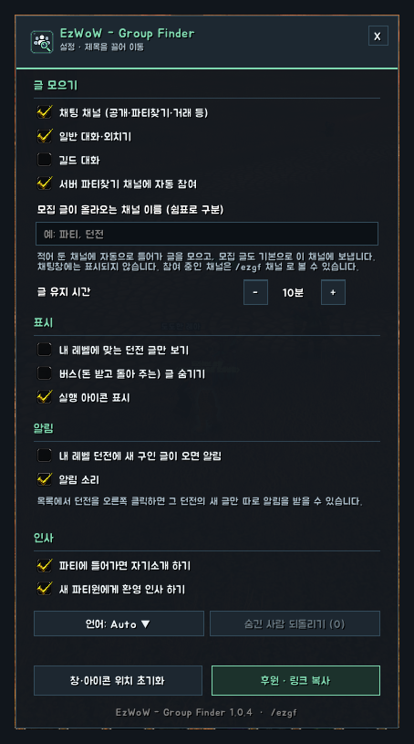
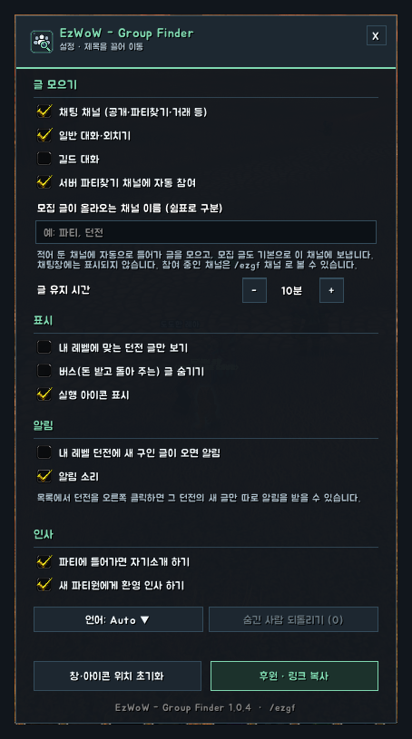

<!--
CurseForge summary (EN): Collects group posts from chat by dungeon with role and level filters, whisper and invite, new-post alerts, an easy post writer and party greetings.
CurseForge summary (KO): 채팅의 파티 모집 글을 던전별로 모아 보기, 역할·레벨 필터, 귓말·초대, 새 글 알림, 모집 글 쓰기, 파티 인사.
-->

# EzWoW - Group Finder

**English** · [한국어](#한국어)

A group finder for WoW Forever. It collects the group posts people write in chat, sorts them by dungeon and shows the roles, size and level each group needs. Whisper or invite with one click, get alerts for the dungeons you want, write your own post in a few clicks, and say hello automatically when a party forms.

*In-game screenshots (WoW Forever, Korean client). Character and player names and chat text are blurred.*

## Features

### Find Group
- Collects group posts from chat channels (General, LFG, Trade, ...), Say/Yell and, optionally, guild chat.
- Joins the server's LFG channel once per login, and any channels you list, in the background (hidden from your chat windows).
- Posts sorted by dungeon; level ranges that suit you are shown in mint, and **For My Level** lists them all at once.
- Each post shows LFM / LFG / boost, the roles needed, group size, level and how long ago it was posted.
- A player's newer post replaces the older one; posts expire after 10 minutes (3–30, adjustable).
- Click a post to whisper; LFG posts have an **Invite** button. Alt+Click hides that player.
- Search and filters: LFM / LFG, hide boosts, my level only, and a **Need (role)** chip that shows only groups looking for your role.

### Write Post
- Pick the post type, dungeon, roles, group size and a note to build the message; edit it freely before sending.
- Choose a channel and send with one click (at most once every 30 seconds).
- **Repost reminder**: after you post, a 'Post again' button and a sound remind you when the chosen interval has passed. Game rules need a click or key press to send chat, so it never posts by itself (a key binding is available). It stops when the group is full or after 10 posts.

### Alerts
- Right-click a dungeon in the list (star) to be alerted about its new posts.
- Optional alerts, with sound, for new LFM posts for your level.
- Alerts that arrive in combat are printed in chat after the fight.

### Greetings (on by default)
- **Introduce myself when I join a party**: says your level, talent tree and class in party chat, e.g. "Hello! Level 16 Feral Combat Druid here." (the talent tree is added when EzWoW - Tooltip is installed; otherwise just the class)
- **Welcome new party members**: greets newcomers by name and surname when they join your party, e.g. "Welcome, Windrift Ashvale! Nice to meet you!" (one line when several join together).
- Parties only, never in a raid; members already in your party are not greeted again after a login or `/reload`. Each can be turned off in the settings.

## Settings (`/ezgf config`)
- **Collect**: chat channels, Say & Yell, guild chat, auto-join the LFG channel, extra channel names, how long posts are kept.
- **Display**: only dungeons for my level, hide boost posts, launcher icon.
- **Alerts**: new LFM posts for my level, alert sound.
- **Greetings**: introduce myself, welcome new members.
- Language (auto + 8 languages), unhide players, reset the window and icon positions.

## Gamepad
- With the gamepad UI on, EzWoW windows work with a gamepad: D-pad to move, A (✕) to press, X (□) for right-click, LB/RB to scroll, B (○) to close. A key guide in your pad's button style shows under the window.
- With no game window open, press **View (Back) / Create** to move to the EzWoW frames on screen. Press it again or B to go back.
- To use another button: Key Bindings > AddOns > EzWoW > "Gamepad: move to / leave the EzWoW frames" (with EzWoW-MapFinder installed).

## Record sharing
- Shared by all EzWoW addons and **on by default**: quest NPCs, rare monster sightings, item drops and gathering spots you have seen yourself are shared with other EzWoW users.
- `/ezshare on` / `off`, `/ezshare channel on` / `off`, `/ezshare status`

## Commands
- `/ezgf` or `/파티찾기` — open the finder
- `/ezgf config` — settings
- `/ezgf post` — write a post
- `/ezgf channels` — list the channels you are in
- `/ezgf icon` — show the launcher icon again

Languages: English, 한국어, Deutsch, Français, Español, Русский, 简体中文, 繁體中文.

---

## 한국어

WoW Forever용 파티 찾기 애드온입니다. 채팅에 올라온 파티 모집 글을 모아 던전별로 나누고, 그룹마다 필요한 역할·인원·레벨을 보여 줍니다. 클릭 한 번으로 귓속말·초대를 하고, 원하는 던전의 새 글 알림을 받고, 모집 글을 쉽게 써서 보내며, 파티가 꾸려지면 자동으로 인사합니다.

*실제 게임 화면입니다(WoW Forever, 한국어 클라이언트). 캐릭터 · 다른 플레이어 이름과 채팅 내용은 가렸습니다.*

## 기능

### 파티 찾기
- 채팅 채널(공개·파티찾기·거래 등), 일반 대화·외치기, 길드 대화(선택)에서 파티 모집 글을 자동으로 모읍니다.
- 서버 파티찾기 채널과 설정에 적어 둔 채널에 보이지 않게 들어가 글을 모읍니다(채팅창에는 표시되지 않음).
- 던전별로 나눠 보여 주고, 내 레벨에 맞는 던전은 레벨 범위를 민트색으로 표시합니다. **내 레벨 추천**에서 한 번에 볼 수 있습니다.
- 글마다 구인/구직/버스, 필요한 역할(탱·힐·딜), 인원, 레벨, 올린 시간이 표시됩니다.
- 같은 사람이 다시 올리면 새 글로 바뀌고, 정해진 시간(기본 10분, 3~30분)이 지나면 사라집니다.
- 글을 클릭하면 귓속말, 구직 글에는 **초대** 버튼이 있습니다. Alt+클릭으로 그 사람 글을 숨깁니다.
- 검색과 필터: 구인·구직, 버스 숨기기, 내 레벨만, 내 역할을 구하는 글만 보는 **(역할) 구함** 칩.

### 모집 글 쓰기
- 모집 방식, 던전, 역할, 인원, 메모를 고르면 글을 만들어 줍니다. 보내기 전에 직접 고칠 수 있습니다.
- 보낼 채널을 고르고 버튼 한 번으로 보냅니다(30초에 한 번까지).
- **반복 알림**: 모집 글을 보낸 뒤 정한 간격이 지나면 '다시 올리기' 버튼과 소리로 알려 줍니다. 채팅 글은 게임 규칙상 직접 눌러야 보낼 수 있어 자동으로 올리지는 않습니다(단축키 지원). 파티가 차거나 10번 올리면 멈춥니다.

### 알림
- 목록에서 던전을 오른쪽 클릭하면(별 표시) 그 던전의 새 글이 올라올 때 알려 줍니다.
- 내 레벨 던전의 새 구인 글 알림과 알림 소리(선택).
- 전투 중에 온 알림은 전투가 끝난 뒤 채팅에 표시합니다.

### 인사 (기본 켬)
- **파티에 들어가면 자기소개 하기**: 파티 채팅에 레벨·특성·직업을 소개합니다. 예: "안녕하세요! 16렙 야성 드루이드입니다." (특성 이름은 EzWoW - Tooltip이 있을 때 붙고, 없으면 직업만)
- **새 파티원에게 환영 인사 하기**: 내 파티에 새 사람이 들어오면 이름과 성을 불러 인사합니다. 예: "바람결 은빛숲님 어서 오세요, 반갑습니다!" (여러 명이 함께 들어오면 "바람결 은빛숲님, 별빛노래 달무리님 어서 오세요, 반갑습니다!"처럼 한 번에).
- 파티에서만 보내고 공격대에서는 보내지 않습니다. 접속하거나 `/reload`한 뒤에는 이미 있던 파티원에게 다시 인사하지 않습니다. 설정에서 각각 끌 수 있습니다.

## 설정 (`/ezgf 설정`)
- **글 모으기**: 채팅 채널, 일반 대화·외치기, 길드 대화, 파티찾기 채널 자동 참여, 추가 채널 이름, 글 유지 시간.
- **표시**: 내 레벨 던전 글만, 버스 글 숨기기, 실행 아이콘 표시.
- **알림**: 내 레벨 던전의 새 구인 글 알림, 알림 소리.
- **인사**: 자기소개, 새 파티원 환영 인사.
- 언어(자동 + 8개 언어), 숨긴 사람 되돌리기, 창·아이콘 위치 초기화.

## 게임패드
- 게임패드 UI를 켜면 EzWoW 창을 패드로 다룰 수 있습니다. 방향키로 이동, A(✕)로 누르기, X(□)로 오른쪽 클릭, LB/RB로 스크롤, B(○)로 닫기입니다. 창 아래에 연결된 패드 모양으로 키 안내가 나옵니다.
- 블리자드 창이 열려 있지 않을 때 **보기(Back) / Create 버튼**을 누르면 화면의 EzWoW 프레임으로 이동합니다. 다시 누르거나 B를 누르면 돌아갑니다.
- 다른 버튼을 쓰려면: 설정 > 단축키 > 애드온 > EzWoW > "게임패드: EzWoW 창으로 이동/돌아가기" (EzWoW-MapFinder 설치 시)

## 기록 공유
- 모든 EzWoW 애드온이 함께 쓰며 **기본으로 켜져 있습니다**. 직접 확인한 퀘스트 NPC, 희귀 몬스터 목격, 아이템 드롭, 채집 위치를 다른 EzWoW 사용자와 나눕니다.
- `/ezshare on` / `off` (또는 `/공유`), `/ezshare channel on` / `off`, `/ezshare status`

## 명령어
- `/ezgf` 또는 `/파티찾기` — 파티 찾기 창 열기
- `/ezgf 설정` — 설정창
- `/ezgf 모집` — 모집 글 쓰기
- `/ezgf 채널` — 참여 중인 채널 보기
- `/ezgf 아이콘` — 실행 아이콘 다시 표시

지원 언어: English, 한국어, Deutsch, Français, Español, Русский, 简体中文, 繁體中文.

---

**Support:** If you find this addon useful, you can support its development. [Buy Me a Coffee ☕](https://buymeacoffee.com/qqhrqqhr2)

**후원:** 애드온이 도움이 되셨다면 개발 후원으로 응원해 주세요. [Buy Me a Coffee ☕](https://buymeacoffee.com/qqhrqqhr2)
